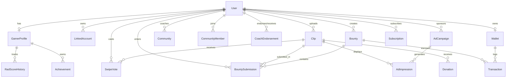

# Play2Pro: Backend Database Architecture & Specification

**Project:** Play2Pro (BARBAH PlayEconomy Ecosystem)  
**Hackathon:** PayPal AI Hackathon  
**Target:** Scalable PostgreSQL Schema with Prisma ORM & Fastify  
**Deployment:** Managed PostgreSQL on Render with Redis / BullMQ caching & queues  

---

## 1. Database Architecture Overview

The **Play2Pro** database is engineered to power an AI-driven, competitive gaming talent economy. It integrates real-time swipe voting (pairwise Elo comparisons), AI clip analysis via Claude Vision, coach cohorts, and financial movements powered by PayPal (Escrow, Orders, Subscriptions, and Payouts).

### Technology Choices
* **RDBMS:** PostgreSQL 15+ (Hosted on Supabase or Render)
* **ORM:** Prisma ORM 5.x (`@prisma/client`) with connection pooling (`pgbouncer`/Supavisor) and `directUrl` for migrations
* **Queue & Caching:** Redis with BullMQ (for asynchronous clip scoring and Elo batching)
* **Idempotency & Auditing:** Cryptographic signature tracking on all PayPal webhook events

---

## 2. Entity Relationship Diagram (ERD)



---

## 3. Core Database Domains

### 3.1. Identity, Roles & Skills Passport
1. **`users`**: Central account table supporting five distinct roles (`GAMER_FREE`, `GAMER_PAID`, `COACH`, `SPONSOR`, `ADMIN`). Includes adult KYC tracking for PayPal transactions.
2. **`gamer_profiles`**: The verified **Gamer ID / Skills Passport**. Stores composite **Rad Score**, **current Elo**, AI skill summaries generated by Claude Vision, and direct booking URLs (Calendly / WhatsApp).
3. **`rad_score_history`**: Time-series log enabling AG Grid and AG Charts to render progress and performance trends over time.
4. **`linked_accounts`**: Verified links to external gaming and streaming accounts (TikTok, YouTube, Twitch, Discord).
5. **`achievements`**: Badges and verified milestone placings.

### 3.2. Gameplay Highlights & Voting Engine
1. **`clips`**: Metadata for short clips (linked or uploaded). Stores Claude Vision tag extractions, detected game, key highlight moments (`JSONB`), and individual clip Elo ratings.
2. **`swipe_votes`**: Pairwise and up/down swipe records. Uses weighted voting (e.g., higher coefficient for coach/verified pro votes to prevent brigading). Unique composite index `(voterId, clipId)` prevents duplicate voting.

### 3.3. Bounties & Escrow System
1. **`bounties`**: Challenges, tournaments, and dares created by coaches or sponsors. Tracks PayPal order authorization (`AUTHORIZE`), hold expiration, and capture IDs.
2. **`bounty_submissions`**: Submissions linked to gameplay clips, tracking Claude Vision auto-verification scores and final creator approval.

### 3.4. Coach Cohorts & Endorsements
1. **`communities`**: Private or public coach cohorts with dedicated member leaderboards and community-specific bounties.
2. **`community_members`**: Membership statuses and join requests.
3. **`coach_endorsements`**: Verified testimonials from coaches that feed directly into the gamer's Rad Score calculation.

### 3.5. Ad Monetization & Revenue Sharing
1. **`ad_campaigns`**: Self-serve sponsor campaigns supporting Feed Ads, Sponsored Bounties, and Leaderboard Banners.
2. **`ad_impressions`**: Impression-level tracking recording ad views, click-throughs, and automated **revenue share credits** deposited into the wallets of paid gamers whose clips served the ad.

### 3.6. Financial Ledger & PayPal Engine
1. **`wallets`**: Real-time balance and pending balance ledger for each gamer.
2. **`transactions`**: Immutable financial ledger tracking all debits and credits:
   * Donations (push-to-pay tips)
   * Bounty escrow holds and payouts
   * Platform commissions
   * Ad revenue sharing
   * PayPal Payouts withdrawals
3. **`paypal_webhook_events`**: Cryptographically validated webhook event log ensuring **idempotent execution** (no double-crediting or duplicate payouts).

---

## 4. File References

The implementation files are located in:
* **Prisma ORM Schema:** [`prisma/schema.prisma`](file:///C:/Users/ANDREW/Documents/BARBAH%20GAMES/PayPal%20hackerthon/Pro2play/prisma/schema.prisma)
* **PostgreSQL Init SQL Script:** [`prisma/init.sql`](file:///C:/Users/ANDREW/Documents/BARBAH%20GAMES/PayPal%20hackerthon/Pro2play/prisma/init.sql)
* **Architecture Blueprint:** [`play2pro_architecture_tech_stack.md`](file:///C:/Users/ANDREW/Documents/BARBAH%20GAMES/PayPal%20hackerthon/Pro2play/Pro2play_mds/play2pro_architecture_tech_stack.md)

---

## 5. Quickstart & Migration Commands

To apply this schema in the Node.js / Fastify backend:

```bash
# 1. Install Prisma dependencies
npm install @prisma/client
npm install prisma --save-dev

# 2. Generate Prisma Client
npx prisma generate

# 3. Create and apply initial migration to PostgreSQL
npx prisma migrate dev --name init_play2pro_schema

# 4. (Optional) Inspect the schema visually in Prisma Studio
npx prisma studio
```
