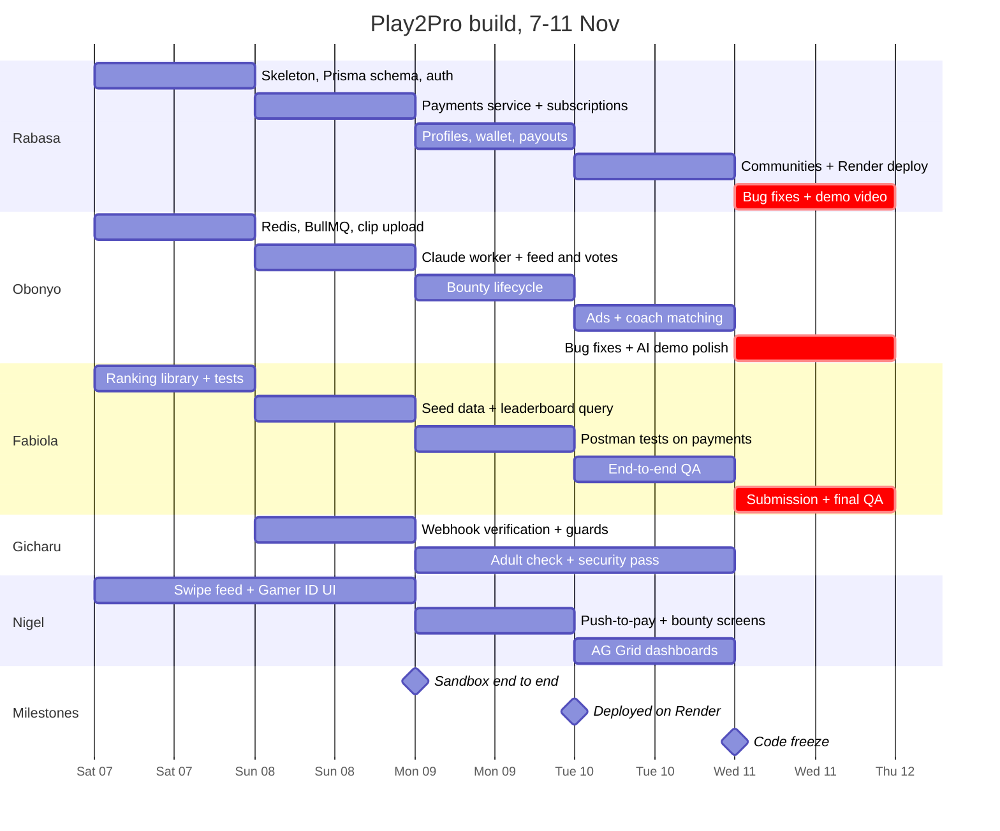

# Play2Pro: Implementation Plan (7–11 Nov)

Nov 7, 2026 · @Rico

The working demo is complete and deployed on Render by Wednesday night, Nov 11, 2026, using two full weekend days and three weekday evenings.

## 1. Time budget and scope

We have roughly 30 working hours per person: two full weekend days and three school-night evenings. Everything below is planned to fit that, with Wednesday night kept light for fixes and the demo video.

| Day | Date | Session | Hours per person (approx.) | Focus |
| --- | --- | --- | --- | --- |
| Sat | 7 Nov | Afternoon + evening | 6 | Setup, schema, skeleton services |
| Sun | 8 Nov | Full day | 9 | Core features end to end in sandbox |
| Mon | 9 Nov | Evening, 7–11 pm | 4 | Payments, bounties, AI wired to UI |
| Tue | 10 Nov | Evening, 7–11 pm | 4 | Ads, communities, dashboards, deploy |
| Wed | 11 Nov | Evening, 7–11 pm | 4 | Freeze, QA, demo video, submission |

Assumption: evenings run 7–11 pm. Adjust the hours column if your schedules differ.

### Must ship (the demo depends on it)

| Feature | Minimum for the demo |
| --- | --- |
| User tiers | Sign-up with Gamer / Coach / Sponsor role; paid tier via PayPal Subscriptions (sandbox) |
| Highlights | Upload clip link, swipe up/down, Elo + rad score, live leaderboard |
| Donations | One-tap push-to-pay donation into the gamer wallet |
| Bounty | Create with authorize, submit clip, AI check, capture + payout |
| Gamer profile | Gamer ID + dashboard (AG Grid / AG Charts), coach can view |
| AI agent | Clip tagging + skill summary via BullMQ worker |
| Ads | House feed ad for free users, hidden for paid users |

### Cut first if we fall behind (in this order)

1. Zapier MCP WhatsApp notifications (show in-app notifications instead)
2. Sponsor ad campaign builder (keep the house ad only)
3. Coach communities beyond create + request to join + approve
4. AI trust and safety flags (mention in the pitch, don't build)
5. Invoicing API (describe in compliance section)

Removed from scope: coach pay-to-unlock footage. Drop it from the tech stack doc and the Zapier triggers.

## 2. Role breakdown

Rabasa owns the platform and the money; Obonyo owns the features and the AI; Fabiola owns ranking logic and quality. Each backend owner works in their own Fastify plugin folder so they rarely touch the same files.

| Person | Owns | Code folders | Key deliverables |
| --- | --- | --- | --- |
| **Rabasa** | Platform foundation, payments, profiles, communities, deployment | `src/plugins/auth`, `payments`, `profiles`, `communities`, `prisma/` | Fastify + TypeScript skeleton; Prisma schema and migrations; auth with roles and tiers; PayPal Orders, Subscriptions, Payouts and wallet ledger; Gamer ID and dashboard endpoints; communities CRUD; Render deploy; Postman collection |
| **Obonyo** | AI agent, highlights, bounties, ads | `src/plugins/clips`, `bounties`, `ads`, `src/workers/` | Redis + BullMQ setup; Claude Vision worker for clip tagging, skill summary and bounty verification; clip upload, feed and vote endpoints; bounty lifecycle (create, enter, verify, release, expire); ad selection with tier check; coach talent matching |
| **Fabiola** | Ranking engine, seed data, QA, submission | `src/lib/ranking/`, `prisma/seed.ts`, `postman/tests` | Elo and rad score as pure, tested functions; leaderboard query; seed script with demo gamers and clips; Postman test runs; end-to-end QA; submission answers |
| Gicharu | Payment security | `src/plugins/webhooks`, auth middleware | PayPal webhook signature verification; role and tier guards; adult-account check before payouts and bounty entry; security pass on payment routes |
| Nigel | Frontend | `web/` (React, Vite, Tailwind) | Swipe feed, Gamer ID, push-to-pay prompt, AG Grid / AG Charts dashboards for gamer, coach and sponsor |

### Hand-offs between the two backend owners

- **Obonyo calls Rabasa's payments service** for bounty money. Rabasa exposes `authorizeOrder()`, `captureOrder()`, `voidAuthorization()` and `payout()` as functions in `src/plugins/payments/service.ts`; Obonyo never calls PayPal directly.
- **Rabasa's profile endpoints read Obonyo's outputs**: AI skill summary and clip tags are written to the database by the worker, and profiles just read them.
- **Both call Fabiola's ranking library** after a vote or a completed bounty: `recordVote()` and `recomputeRadScore(gamerId)`.

## 3. Timeline

The backend is feature-complete in sandbox by Monday night, deployed Tuesday, and frozen Wednesday at 9 pm.

## 4. Day-by-day plan

Each day ends with a "done when" check that the next day depends on. Tick tasks off as you go.

### Sat 7 Nov: foundation (afternoon + evening)

[[Rabasa]]

- [ ] Create the repo: Fastify + TypeScript, ESLint, `.env.example`, folder per plugin
- [ ] Write the Prisma schema with Obonyo (section 5) and run the first migration on local Postgres
- [ ] Auth: sign-up and login (JWT), `role` (GAMER, COACH, SPONSOR) and `tier` (FREE, PAID) on User
- [ ] Create PayPal sandbox app; store client ID and secret; get an access token from Fastify

**Obonyo**

- [ ] Redis + BullMQ: `clip-analysis` queue and a worker process that logs jobs
- [ ] `POST /api/v1/clips`: save clip link + description, enqueue analysis job
- [ ] Claude Vision prompt for clip tagging: returns JSON with game, key moments, stats, tags. Test on 3 sample clips from Rabasa's media set

**Fabiola**

- [ ] `src/lib/ranking`: Elo update for a pairwise vote, with K-factor and vote weight (coach and verified votes heavier)
- [ ] Draft rad score formula with placeholder weights; agree weights with the team on Sunday morning
- [ ] Unit tests for both

**Done when:** a clip can be posted locally, its job is picked up by the worker, and the ranking tests pass.

### Sun 8 Nov: core features (full day)

**Rabasa**

- [ ] Payments service: `createOrder()` (CAPTURE) for donations, `authorizeOrder()`, `captureOrder()`, `voidAuthorization()` for bounties
- [ ] `POST /api/v1/donations`: create order, return approval link (push-to-pay)
- [ ] Wallet ledger table: every credit and debit written in one transaction
- [ ] Subscriptions: create Paid Gamer and Coach plans in sandbox; `POST /api/v1/subscriptions`; flip `tier` to PAID on webhook
- [ ] Postman collection with sandbox environment shared with the team

**Obonyo**

- [ ] Worker calls Claude, writes tags, stats and AI quality score to the clip
- [ ] Skill summary job: regenerate the Gamer ID summary after each analysed clip
- [ ] `GET /api/v1/feed` (paged, excludes own clips) and `POST /api/v1/clips/:id/vote` (up or down)
- [ ] Vote handler calls Fabiola's `recordVote()` and `recomputeRadScore()`

**Fabiola**

- [ ] Finalise rad score weights with the team
- [ ] `GET /api/v1/leaderboard?game=` query, ordered by rad score
- [ ] `prisma/seed.ts`: 15 demo gamers, 2 coaches, 1 sponsor, 40 clips with votes

**Gicharu**

- [ ] `POST /api/v1/webhooks/paypal`: verify signature with PayPal's verify endpoint before any handler runs
- [ ] Role and tier guard middleware for Fastify routes

**Done when:** in sandbox, a donation is approved and the webhook credits the wallet; voting on seeded clips changes the leaderboard.

### Mon 9 Nov: money and bounties (7–11 pm)

**Rabasa**

- [ ] `payout()` via Payouts API and `POST /api/v1/wallet/withdraw`
- [ ] `GET /api/v1/gamers/:id` (Gamer ID) and `GET /api/v1/gamers/:id/dashboard` (stats for AG Charts)

**Obonyo**

- [ ] Bounty endpoints: create (calls `authorizeOrder()`), list, enter, submit clip
- [ ] Verification job: Claude checks the clip against the bounty task; creator confirms; then `captureOrder()` + `payout()`
- [ ] Expiry job: void authorization after the deadline

**Fabiola**

- [ ] Postman tests for donation, subscription, bounty and withdraw flows in sandbox
- [ ] Log every bug with steps to reproduce in the team tracker

**Gicharu**

- [ ] Block withdraw and bounty entry unless the PayPal account is verified adult

**Done when:** a full bounty runs in sandbox: authorize, submit, AI verify, capture, payout, rad score update.

### Tue 10 Nov: ads, communities, deploy (7–11 pm)

**Rabasa**

- [ ] Communities: create, request to join, approve or decline, members' dashboards for the coach
- [ ] Deploy to Render: web service, managed Postgres, Redis, worker; run migrations and seed
- [ ] Point PayPal sandbox webhooks at the Render URL

**Obonyo**

- [ ] `GET /api/v1/ads/next`: returns a house ad for free users, nothing for paid users; frequency cap per session
- [ ] Coach matching: `GET /api/v1/coach/matches` ranks gamers by game, role, region and rad score trend
- [ ] Stretch: Zapier MCP trigger for bounty payout notification on WhatsApp

**Fabiola**

- [ ] End-to-end QA on the Render URL with the demo script, as each of the three tiers

**Done when:** the whole demo script works on the deployed URL.

### Wed 11 Nov: freeze and submit (7–11 pm)

- [ ] 7–9 pm: everyone fixes bugs from Fabiola's list, highest demo impact first
- [ ] 9 pm: code freeze; no new features
- [ ] Rabasa: record the demo video against the deployed app
- [ ] Obonyo: prepare 2–3 clips that give clean, impressive AI output for the live demo
- [ ] Fabiola: final QA pass, submission answers, links to repo, video and pitch doc
- [ ] Submit before midnight

## 5. API contract and data model

Agree this contract on Saturday before splitting up, so Nigel can build against Postman mocks while the backend fills in.

### Endpoints

| Method + path | Owner | Purpose | Ready by |
| --- | --- | --- | --- |
| `POST /auth/signup`, `POST /auth/login` | Rabasa | Account with role and tier | Sat |
| `POST /api/v1/clips` | Obonyo | Add clip link + description, queue AI job | Sat |
| `GET /api/v1/feed` | Obonyo | Paged swipe feed | Sun |
| `POST /api/v1/clips/:id/vote` | Obonyo | Up or down vote | Sun |
| `GET /api/v1/leaderboard?game=` | Fabiola | Ranked by rad score | Sun |
| `POST /api/v1/donations` | Rabasa | Create order, return approval link | Sun |
| `POST /api/v1/subscriptions` | Rabasa | Start Paid Gamer or Coach plan | Sun |
| `POST /api/v1/webhooks/paypal` | Gicharu (verify) + Rabasa (handlers) | Payment, subscription and payout events | Sun |
| `GET /api/v1/gamers/:id` | Rabasa | Gamer ID | Mon |
| `GET /api/v1/gamers/:id/dashboard` | Rabasa | Stats for AG Charts | Mon |
| `POST /api/v1/wallet/withdraw` | Rabasa | Payout to gamer | Mon |
| `POST /api/v1/bounties`, `GET /api/v1/bounties` | Obonyo | Create (authorize) and list | Mon |
| `POST /api/v1/bounties/:id/submissions` | Obonyo | Submit clip, queue verification | Mon |
| `POST /api/v1/bounties/:id/confirm` | Obonyo | Creator confirms, capture + payout | Mon |
| `POST /api/v1/communities`, `.../join`, `.../requests/:id` | Rabasa | Create, request, approve | Tue |
| `GET /api/v1/ads/next` | Obonyo | Ad for free users only | Tue |
| `GET /api/v1/coach/matches` | Obonyo | AI talent matches | Tue |

### Prisma models

Rabasa writes the schema file; each model's owner is the only one who changes it after Saturday.

| Model | Owner | Key fields |
| --- | --- | --- |
| User | Rabasa | role, tier, paypalPayerId, isVerifiedAdult |
| GamerProfile | Rabasa | gamerTags, platforms, games, region, aiSummary, radScore |
| Clip | Obonyo | url, description, game, tags, stats, aiQualityScore, eloRating |
| Vote | Obonyo | clipId, voterId, direction, weight |
| Bounty | Obonyo | type (CHALLENGE, TOURNAMENT, DARE), reward, deadline, status, paypalOrderId, authorizationId |
| BountySubmission | Obonyo | bountyId, clipId, aiVerdict, confirmed |
| WalletEntry | Rabasa | userId, amount, kind (DONATION, BOUNTY, AD\_SHARE, WITHDRAWAL), paypalRef |
| Subscription | Rabasa | userId, plan, paypalSubscriptionId, status |
| Community, CommunityMember | Rabasa | coachId, name; memberId, status |
| AdImpression | Obonyo | userId, adId, clipOwnerId |
| Endorsement | Fabiola | coachId, gamerId (input to rad score) |

## 6. Sync points, risks and fallbacks

### Sync points

| When | Who | Purpose |
| --- | --- | --- |
| Sat, start of session | Everyone | Agree API contract and Prisma schema (section 5) |
| Sun, morning | Everyone | Agree rad score weights; check Saturday's done-when |
| Sun, evening | Rabasa, Obonyo, Gicharu | First full donation through the webhook |
| Mon–Wed, 7 pm | Everyone, 10 min | What's blocked; Fabiola reads out top bugs |
| Mon–Wed, 11 pm | Everyone | Push and merge to `main`; Render redeploys |

Git rules: one branch per person per feature, small pull requests, Rabasa merges to `main`. Nobody edits another owner's plugin folder without asking first.

### Risks

| Risk | Fallback |
| --- | --- |
| PayPal sandbox webhooks are slow or flaky during the demo | Keep a "simulate webhook" Postman request that replays a signed sample event; poll order status as backup |
| Claude Vision is slow on long clips | Analyse a thumbnail strip (a few frames) plus the gamer's description instead of the full video; pre-analyse demo clips Wednesday |
| Authorization expiry vs bounty deadline | Demo bounties use short deadlines (hours, not days) |
| Payouts sandbox needs extra account setup | Set up sandbox personal accounts for gamers on Saturday, not Monday |
| Render free tier sleeps and cold-starts | Hit the URL a few minutes before demoing; upgrade if credits allow |
| School night runs short | Follow the cut list in section 1; never cut payments or bounties |
| Rabasa and Obonyo both blocked on schema changes | Schema changes after Saturday go through the model owner only |

## 7. Demo-ready checklist

Fabiola signs off each item on the deployed Render URL before the 9 pm freeze on Wednesday.

- [ ] Sign up as Gamer, Coach and Sponsor; tiers show the right ads (free sees ads, paid doesn't)
- [ ] Add a clip; AI tags and skill summary appear on the Gamer ID within a minute
- [ ] Swipe on clips; rad score and leaderboard update
- [ ] Donate with push-to-pay; wallet updates after the webhook
- [ ] Sponsor creates a bounty (authorized), gamer submits, AI verifies, sponsor confirms, funds captured and paid out
- [ ] Expired bounty voids the authorization
- [ ] Coach views a gamer's dashboard (AG Charts), approves a community join request, sees AI matches
- [ ] Gamer withdraws from the wallet via Payouts
- [ ] Subscription upgrade flips the user to PAID and removes ads
- [ ] Forged webhook (bad signature) is rejected
- [ ] Demo video recorded; repo, video and pitch doc linked in the submission
