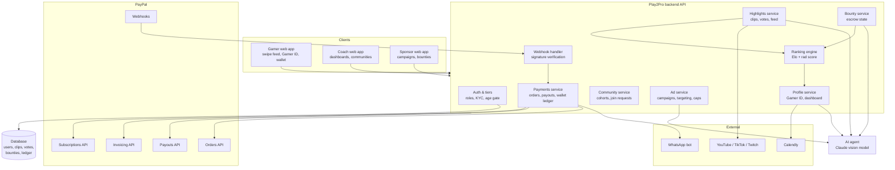
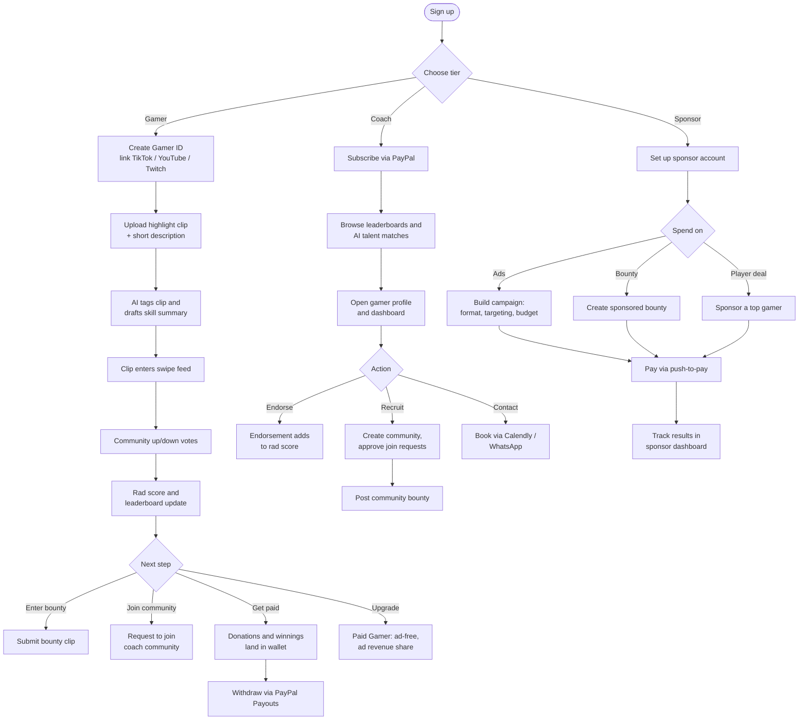
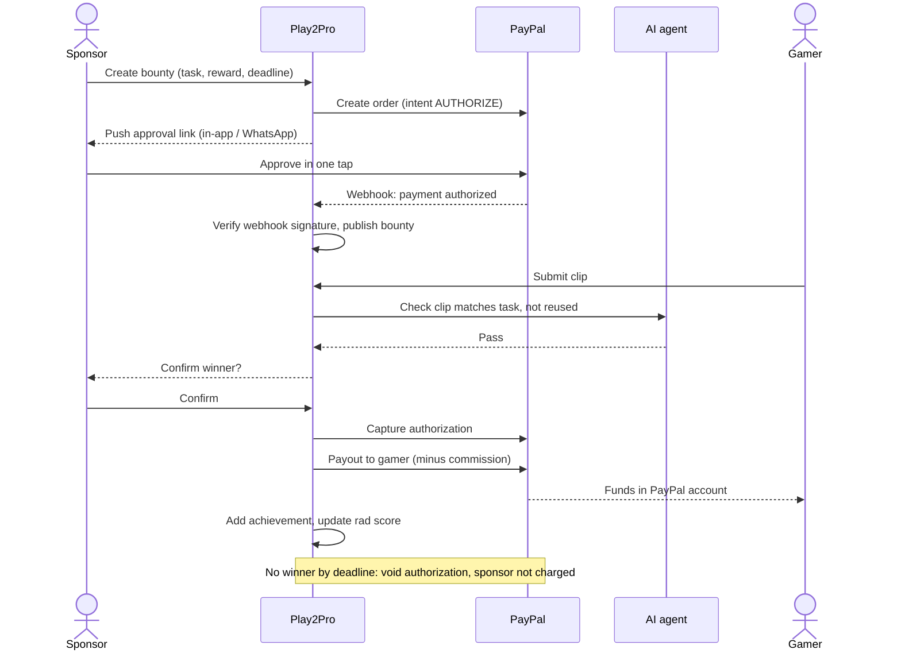

## tech stack 
[[play2pro_architecture_tech_stack]] · [[Home]] · [[Play2Pro Implementation Plan (7–11 Nov)]] · [[Database]]

# Play2Pro: Turning Casual Gamers into Professionals

Team Quest · PayPal Hackathon · Nov 7, 2026 · @Rico

## Overview

Play2Pro turns scattered gameplay clips into a verified, ranked Gamer ID that coaches and sponsors trust, and pays gamers for it through PayPal. **The gamer is the product. Coaches and sponsors are the customers.**

**The problem.** Talented casual gamers can't prove they're good. Their best plays are lost among TikTok and YouTube clips, and rank screenshots are easy to fake. Coaches and sponsors looking for talent dig through that noise by hand.

**The solution in five features:**

1. **User tiers**: Gamer (free or paid), Coach, Sponsor.
2. **Gameplay highlights**: community up/down votes feed a consolidated rad score and the leaderboard; fans can donate.
3. **Bounties**: challenges, tournaments and dares, funded through PayPal escrow.
4. **Gamer profile**: a Gamer ID plus a progress and engagement dashboard that coaches can view.
5. **AI agent**: analyses clips, builds summaries, matches talent and flags abuse.

> Change from the previous draft: coaches no longer pay per video to unlock long-form footage. Coach access to gamer profiles is included in the Coach tier.

## 1. User tiers

Three account types, each with its own price, ad experience and tools. All paid tiers bill through the PayPal Subscriptions API.

| Tier | Plan | Ads | What they get |
| --- | --- | --- | --- |
| Gamer | Free | Ads shown | Gamer ID, clip uploads, voting, bounty entry, donations received |
| Gamer | Paid | No ads | Monetized content (share of ad revenue on their clips), boosted visibility, full dashboard analytics, lower donation fee |
| Coach | Paid | No ads | Full access to gamer profiles, AI analytics, talent matching, private communities |
| Sponsor | Free account, pays per campaign | Ads shown | Post bounties, run ad campaigns, sponsor top-ranked gamers |

### Coach communities

Coaches can create communities for their own cohort. Gamers browse communities and request to join, and the coach approves or declines.

- A community has a member list, a shared leaderboard, and community-only bounties the coach posts.
- The coach sees each member's dashboard side by side to track progress.
- Joining a community is a visible credibility signal on the gamer's profile.
- Open question: are communities free to join, or can coaches charge a membership fee through PayPal?

### Coach AI analytics

The coach dashboard uses the AI agent to compare players by game, role, region and rad-score trend, and to surface rising players before they top the leaderboard.

## 2. Gameplay highlights

Gamers post short highlight clips (linked from TikTok, YouTube or Twitch). The community votes on them, and the votes drive the leaderboard.

### Up/down voting

Viewers swipe up (upvote) or down (downvote) on clips. We chose this over 5-star ratings because swiping is faster, so more people vote, and star ratings cluster at 4–5 until they stop meaning anything.

Votes are turned into a fair score with **pairwise comparison and an Elo-style rating**, the method used in chess and game matchmaking. Votes from coaches and verified gamers carry more weight, which limits manipulation.

### The rad score

The rad score is a single consolidated credibility score shown on the Gamer ID and used to rank the leaderboard per game. It combines:

| Input | What it measures |
| --- | --- |
| Community votes (Elo-weighted) | How highlights perform against other players' clips |
| Bounties completed | Results someone put money behind (strongest signal) |
| Tournament results | Verified competitive placings |
| Coach endorsements | Expert judgement |
| AI quality score | Clip quality, so new players aren't buried for having no followers |
| Engagement | Views, watch time and follows on Play2Pro |

The weights are a team decision to settle before the demo.

### Donations

Fans tip gamers directly on a clip or profile. Payment uses the push-to-pay flow (section 6) and lands in the gamer's profile wallet, minus a small platform fee. Gamers withdraw through PayPal Payouts.

### Ads

Free users see ads between clips in the highlight feed. Paid users browse ad-free. See section 6 for the full ad model.

## 3. Bounties

Anyone with a verified adult PayPal account can create a bounty or take part in one. Bounties are the strongest evidence of skill, because someone put money behind the result.

| Type | Example | Typical creator |
| --- | --- | --- |
| Challenge | "Clutch a 1v3 in Valorant" | Sponsor or coach |
| Tournament | Top 3 in a weekend FC 25 bracket split the pool | Sponsor or coach community |
| Dare | "Win a round using only a pistol" | Fans or other gamers |

### How escrow works

1. **Create.** The creator sets the task, reward and deadline. Play2Pro creates a PayPal order with intent `AUTHORIZE`, so the money is held but not taken.
2. **Enter.** Gamers join and submit a clip before the deadline.
3. **Verify.** The AI agent checks the clip (right game, task done, not reused), then the creator or a coach confirms.
4. **Release.** Play2Pro captures the authorization, keeps its commission, and pays the winner through PayPal Payouts.
5. **Expire.** If nobody completes it by the deadline, the authorization is voided and the creator is never charged.

PayPal authorizations have a time limit, so bounty deadlines are capped inside PayPal's hold period. Exact limits to confirm in PayPal's documentation.

A completed bounty shows on the Gamer ID as a verified achievement and adds to the rad score.

## 4. Gamer profile

Every gamer's profile has two parts: a public **Gamer ID** that proves who they are and what they've done, and a **dashboard** that shows how they're growing. Coaches have full access to both.

### Gamer ID

- Name and gamer tags
- Platforms and linked accounts (TikTok, YouTube, Twitch), games played, roles, region
- Rad score and leaderboard position per game
- Verified achievements: bounties completed, tournament results, coach endorsements, community memberships
- AI-generated skill summary
- Booking link for coaching or contact (Calendly, then a WhatsApp bot)

### Dashboard

- Rad score trend over time
- Clip performance: votes, views, watch time
- Engagement: followers, donations received, bounties entered and won
- Wallet: earnings, donations, payout history, withdraw button (PayPal Payouts)

### Who sees what

| Viewer | Gamer ID | Dashboard |
| --- | --- | --- |
| Public / free users | Yes | No |
| Coaches | Yes | Yes, read-only |
| Sponsors | Yes | Summary stats only |
| The gamer | Yes | Yes, plus wallet |

## 5. AI agent

One AI agent, built on Claude's vision model, runs behind every feature. It does five jobs:

| Job | What it does | Feeds into |
| --- | --- | --- |
| Clip analysis | Identifies the game and key moments, extracts stats (kills, objectives), auto-tags the clip. Uses the gamer's own description to speed up tagging | Highlights feed, Gamer ID |
| Profile summary | Drafts the skill summary on the Gamer ID and keeps it updated | Gamer ID |
| Bounty verification | Checks a submitted clip matches the bounty task before release | Bounty escrow |
| Matching & coach analytics | Recommends gamers to coaches and sponsors by game, role, rad score and region; flags rising players | Coach dashboard, sponsor campaigns |
| Trust & safety | Flags vote manipulation, reused or stolen clips, and toxic comments | Rad score, moderation queue |

The AI quality score is one input to the rad score, so a strong new player gets seen even before the community has voted much.

## 6. Ads, payments and business model

Sponsors buy ads and bounties; free users see the ads; paid gamers earn a share of the ad revenue their clips generate. Every payment runs through PayPal.

### Ad functionality

Sponsors build campaigns in a self-serve dashboard: pick a format, target audience and budget, pay through PayPal, then track results.

| Format | Where it appears | Sold as |
| --- | --- | --- |
| Feed ad | A sponsored clip between highlights in the swipe feed, skippable after 5 seconds | Cost per 1,000 views |
| Sponsored bounty | A branded challenge pinned at the top of the bounty board | Bounty reward + placement fee |
| Leaderboard sponsorship | "Valorant leaderboard presented by \[brand\]" banner | Flat weekly fee |
| Player sponsorship | A sponsor badge on a top gamer's Gamer ID | Deal between sponsor and gamer; platform takes a cut |

**Rules that keep ads fair:**

- **Who sees ads:** free gamers and sponsors see them; paid gamers and coaches never do.
- **Targeting:** by game, region and audience age band. No personal data is sold to sponsors.
- **Frequency cap:** a set number of feed ads per session, so the feed stays fun (exact cap to agree).
- **Revenue share:** ad views on a paid gamer's clips earn that gamer a share, paid into their wallet. This is what "monetizes content" means for the paid tier.
- **Brand safety:** the AI agent screens ad creatives and keeps ads off flagged or toxic content.
- **Reporting:** sponsors see impressions, clicks, bounty entries and follower growth for sponsored gamers.
- **Prototype:** the demo runs house ads (Play2Pro promos) to show placement and the ad-free switch.

### Push-to-pay

Inspired by mobile money push prompts, rebuilt entirely on PayPal: the platform creates a PayPal order, pushes the approval link to the payer (in-app or WhatsApp), the payer approves in one tap, and a PayPal webhook confirms the payment in real time. Used for donations, bounty funding and sponsor campaigns.

### Revenue streams

| Stream | Who pays | PayPal tool |
| --- | --- | --- |
| Paid Gamer and Coach subscriptions | Gamers, coaches | Subscriptions API |
| Ads and sponsorships | Sponsors | Orders API + Invoicing API |
| Bounty commission | Taken from the bounty pool on release | Orders API (authorize, then capture) |
| Donation fee | Taken from each tip | Orders API |
| Gamer withdrawals and ad revenue share | Paid out to gamers | Payouts API |

## 7. System architecture

A single web app talks to one backend API; the backend owns the database and brokers every call to PayPal, the AI agent and the external platforms.

**How it fits together:**

- **Highlights service** pulls clip metadata and engagement from YouTube, TikTok and Twitch, sends clips to the AI agent for tagging, and passes votes to the ranking engine.
- **Ranking engine** turns votes into Elo ratings, combines them with bounties, endorsements and AI scores into the rad score, and updates the leaderboard and Gamer ID.
- **Payments service** is the only part that talks to PayPal. It keeps an internal wallet ledger for every gamer and pushes approval links over WhatsApp.
- **Webhook handler** verifies every PayPal webhook signature before marking anything paid, so confirmations can't be faked.
- **Ad service** picks which ad to show, skips it for paid tiers, enforces frequency caps and records views for the revenue share.

## 8. User flows

### Main journey by tier

Everyone signs up the same way, then branches by tier.

### Bounty with escrow

The money is held when the bounty is posted and only taken when a winner is verified.

## 9. Compliance

- **Payments:** all money moves through PayPal, so every transaction is recorded and PayPal's buyer and seller protections apply.
- **Escrow:** bounty funds are authorized on posting and captured only on verification; deadlines sit inside PayPal's hold period.
- **Subscriptions:** PayPal Subscriptions API, with clear recurring billing, easy cancellation and automatic receipts.
- **Tax invoices:** PayPal Invoicing API for subscriptions, ad campaigns and commissions, aligned with KRA eTIMS. Gamers get payout statements for their own tax filing.
- **KYC and age:** many gamers are under 18. Withdrawals, bounty entry and donations received require a verified adult PayPal account holder. Ad targeting uses age bands only.
- **Security:** webhook signatures verified; payment flows penetration-tested.
- **Data protection:** profile and payment data handled under Kenya's Data Protection Act.

Escrow limits and tax details to be confirmed with PayPal's documentation and a tax advisor before launch.

## 10. Demo script

1. **Sign up** as a gamer and create a Gamer ID by linking a clip.
2. **Watch the AI** tag the clip and write the skill summary.
3. **Swipe** on clips and watch the rad score and leaderboard update live; a free user sees a feed ad, a paid user doesn't.
4. **Donate** to a gamer with the one-tap push-to-pay prompt.
5. **Run a bounty:** a sponsor posts it, a gamer submits a clip, the AI verifies it, funds are captured and paid out.
6. **Coach view:** open a gamer's dashboard, approve their request to join a community, and book a call.
7. **Get paid:** the gamer withdraws from their wallet via PayPal Payouts.

## Team roles

| Member | Role | Owns |
| --- | --- | --- |
| [[Obonyo]] | Product Lead & AI Engineer | Scope; AI agent (clip analysis, summaries, matching, verification); database schema with Rabasa |
| [[Fabiola]] | Project Manager, QA & Submission | Timeline; pitch doc and submission; Elo and rad score logic; end-to-end QA |
| [[Gicharu]] | Payments Security & Integration | PayPal security, webhook verification, escrow, KYC and age checks; pen testing |
| [[Rabasa]] | Backend, DevOps & Media | Backend APIs incl. ad and community services; PayPal code with Gicharu; deployment; demo video |
| [[Nigel]] | UI/UX Lead & User Research | Swipe feed, Gamer ID, dashboards, push-to-pay prompt; gamer interviews; usability tests |
