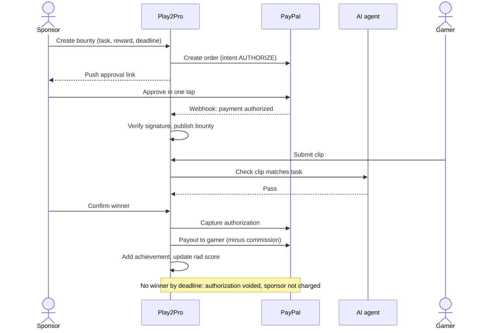
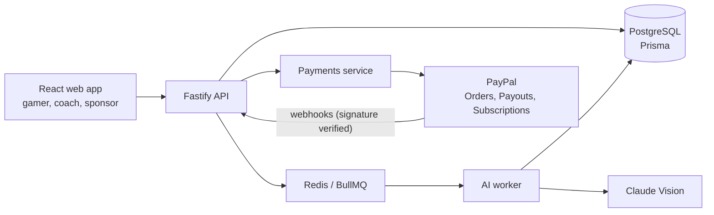

# Play2Pro

**Turning casual gamers into professionals.**

Play2Pro turns scattered gameplay clips into a verified, ranked **Gamer ID** that coaches and sponsors trust, and pays gamers for it through PayPal.

> The gamer is the product. Coaches and sponsors are the customers.

Built by **Team Quest** for the **PayPal AI Hackathon** (November 2026).

---

## Table of contents

- [The problem](#the-problem)
- [Features](#features)
- [How it works](#how-it-works)
- [Tech stack](#tech-stack)
- [Architecture](#architecture)
- [Getting started](#getting-started)
- [Environment variables](#environment-variables)
- [Running the app](#running-the-app)
- [Project structure](#project-structure)
- [API reference](#api-reference)
- [Data model](#data-model)
- [Testing](#testing)
- [Deployment](#deployment)
- [Demo walkthrough](#demo-walkthrough)
- [Security and compliance](#security-and-compliance)
- [Roadmap](#roadmap)
- [Team](#team)

---

## The problem

Talented casual gamers can't prove they're good. Their best plays are lost among TikTok and YouTube clips, and rank screenshots are easy to fake. Coaches and sponsors looking for talent dig through that noise by hand.

Play2Pro gives gamers verified, ranked evidence of skill, and a direct way to earn from it.

## Features

### 1. User tiers

| Tier | Plan | Ads | What they get |
| --- | --- | --- | --- |
| Gamer | Free | Shown | Gamer ID, clip uploads, voting, bounty entry, donations received |
| Gamer | Paid | None | Ad revenue share on their clips, boosted visibility, full dashboard analytics, lower donation fee |
| Coach | Paid | None | Full access to gamer profiles and dashboards, AI talent matching, private communities |
| Sponsor | Free account, pays per campaign | Shown | Post bounties, run ad campaigns, sponsor top-ranked gamers |

Paid tiers are billed through the **PayPal Subscriptions API**.

### 2. Gameplay highlights

- Gamers post short highlight clips linked from TikTok, YouTube or Twitch, with an optional description.
- Viewers **swipe up to upvote, down to downvote**. Swiping is faster than star ratings, so more people vote, and the scores don't cluster at 4–5 stars.
- Votes are converted into a fair score using **pairwise comparison with an Elo-style rating**. Votes from coaches and verified gamers carry more weight to limit manipulation.
- Fans can **donate** to a gamer directly from a clip or profile using one-tap push-to-pay.

### 3. Bounties

Challenges, tournaments and dares funded through PayPal escrow. The reward is held when the bounty is posted and only taken when a winner is verified.

| Type | Example |
| --- | --- |
| Challenge | "Clutch a 1v3 in Valorant" |
| Tournament | Top 3 in a weekend FC 25 bracket split the pool |
| Dare | "Win a round using only a pistol" |

A completed bounty appears on the Gamer ID as a verified achievement and boosts the rad score.

### 4. Gamer profile

- **Gamer ID** (public): gamer tags, platforms, games, roles, region, rad score and leaderboard position, verified achievements, AI skill summary, and a booking link.
- **Dashboard**: rad score trend, clip performance, engagement, and a wallet with earnings, donations, payout history and a withdraw button.

| Viewer | Gamer ID | Dashboard |
| --- | --- | --- |
| Public / free users | Yes | No |
| Coaches | Yes | Yes, read-only |
| Sponsors | Yes | Summary stats only |
| The gamer | Yes | Yes, plus wallet |

### 5. AI agent

One agent built on **Claude's vision model** runs behind every feature:

| Job | What it does |
| --- | --- |
| Clip analysis | Identifies the game and key moments, extracts stats, auto-tags the clip |
| Bounty verification | Checks a submitted clip matches the bounty task |

### Ads

Free users see a feed ad between clips; paid gamers and coaches browse ad-free. Ad frequency is capped per session. The prototype serves **house ads** to demonstrate placement and the ad-free switch.

## How it works

### The rad score

The rad score is a single credibility score shown on the Gamer ID and used to rank the per-game leaderboard. It combines:

| Input | What it measures |
| --- | --- |
| Community votes (Elo-weighted) | How highlights perform against other players' clips |
| Bounties completed | Results someone put money behind (strongest signal) |
| Tournament results | Verified competitive placings |
| Coach endorsements | Expert judgement |
| AI quality score | Clip quality, so new players aren't buried for having no followers |
| Engagement | Views, watch time and follows on Play2Pro |

The ranking logic lives in `src/lib/ranking/` as pure, unit-tested functions.

### Push-to-pay

Inspired by mobile money push prompts and built entirely on PayPal:

1. Play2Pro creates a PayPal order.
2. The approval link is pushed to the payer in-app.
3. The payer approves in PayPal with one tap.
4. A verified PayPal webhook confirms the payment and credits the gamer's wallet.

Used for donations, bounty funding and sponsor payments.

### Bounty escrow



## Tech stack

| Layer | Technologies |
| --- | --- |
| Frontend | React, Vite, Tailwind CSS, AG Grid, AG Charts |
| Backend API | Node.js, TypeScript, Fastify |
| Database | PostgreSQL, Prisma ORM |
| Background jobs | Redis, BullMQ |
| AI | Claude Vision API |
| Payments | PayPal Orders, Payouts and Subscriptions APIs, webhooks |
| API testing | Postman |
| Hosting | Render (web service, managed Postgres, Redis, worker) |

## Architecture

The web app talks to one Fastify API. The backend owns the database and is the only part that calls PayPal and the AI agent. Heavy AI work runs in a BullMQ worker so HTTP requests never block.



**Clip flow:** `POST /api/v1/clips` saves the clip and enqueues a `clip-analysis` job → the worker calls Claude → tags, stats, an AI quality score and an updated skill summary are written to the database → votes on the clip update its Elo rating and the gamer's rad score.

## Getting started

### Prerequisites

- Node.js 20 or later and npm
- PostgreSQL 15 or later
- Redis 7 or later
- A [PayPal Developer](https://developer.paypal.com) sandbox app (client ID and secret), plus sandbox business and personal accounts
- An [Anthropic API](https://console.anthropic.com) key

### Installation

```bash
# 1. Clone the repository
git clone <repo-url> play2pro
cd play2pro

# 2. Install backend dependencies
npm install

# 3. Install frontend dependencies
cd web && npm install && cd ..

# 4. Create your environment file
cp .env.example .env
# then fill in the values (see below)

# 5. Run database migrations and seed demo data
npx prisma migrate dev
npx prisma db seed
```

The seed script creates 15 demo gamers, 2 coaches, 1 sponsor and 40 clips with votes, so the feed and leaderboard work immediately.

## Environment variables

| Variable | Description |
| --- | --- |
| `DATABASE_URL` | PostgreSQL connection string |
| `REDIS_URL` | Redis connection string for BullMQ |
| `JWT_SECRET` | Secret used to sign auth tokens |
| `PAYPAL_CLIENT_ID` | PayPal sandbox app client ID |
| `PAYPAL_CLIENT_SECRET` | PayPal sandbox app secret |
| `PAYPAL_WEBHOOK_ID` | ID of the registered webhook, used for signature verification |
| `PAYPAL_API_BASE` | `https://api-m.sandbox.paypal.com` for sandbox |
| `PAYPAL_PLAN_ID_GAMER` | Subscription plan ID for Paid Gamer |
| `PAYPAL_PLAN_ID_COACH` | Subscription plan ID for Coach |
| `ANTHROPIC_API_KEY` | API key for the Claude Vision worker |
| `APP_URL` | Public base URL, used for PayPal return and cancel URLs |

Never commit `.env`. Only `.env.example` belongs in version control.

## Running the app

Run each process in its own terminal:

```bash
# API server
npm run dev

# AI worker (clip analysis, skill summaries, bounty verification, expiry)
npm run worker

# Frontend
cd web && npm run dev
```

To receive PayPal sandbox webhooks locally, expose the API with a tunnel (for example ngrok) and register `<tunnel-url>/api/v1/webhooks/paypal` in your PayPal app's webhook settings.

## Project structure

```
play2pro/
├── prisma/
│   ├── schema.prisma        # Data model
│   └── seed.ts              # Demo gamers, coaches, sponsor and clips
├── src/
│   ├── plugins/
│   │   ├── auth/            # Sign-up, login, roles and tiers
│   │   ├── payments/        # PayPal orders, subscriptions, payouts, wallet ledger
│   │   ├── webhooks/        # PayPal webhook signature verification
│   │   ├── profiles/        # Gamer ID and dashboard
│   │   ├── communities/     # Coach communities and join requests
│   │   ├── clips/           # Clip upload, feed and voting
│   │   ├── bounties/        # Bounty lifecycle
│   │   └── ads/             # Ad selection and tier check
│   ├── lib/
│   │   └── ranking/         # Elo and rad score (pure functions + tests)
│   └── workers/             # BullMQ workers calling Claude
├── postman/                 # Collection, sandbox environment and tests
└── web/                     # React + Vite + Tailwind frontend
```

## API reference

All routes except auth are prefixed with `/api/v1` and require a JWT in the `Authorization: Bearer <token>` header. Role and tier guards are applied per route.

| Method | Path | Description |
| --- | --- | --- |
| `POST` | `/auth/signup` | Create an account with a role (Gamer, Coach, Sponsor) |
| `POST` | `/auth/login` | Log in and receive a JWT |
| `POST` | `/clips` | Add a clip link and description; queues AI analysis |
| `GET` | `/feed` | Paged swipe feed (excludes your own clips) |
| `POST` | `/clips/:id/vote` | Upvote or downvote a clip |
| `GET` | `/leaderboard?game=` | Gamers ranked by rad score for a game |
| `POST` | `/donations` | Create a donation order; returns the approval link |
| `POST` | `/subscriptions` | Start a Paid Gamer or Coach subscription |
| `POST` | `/webhooks/paypal` | Receives PayPal payment, subscription and payout events |
| `GET` | `/gamers/:id` | Gamer ID |
| `GET` | `/gamers/:id/dashboard` | Dashboard stats for AG Charts |
| `POST` | `/wallet/withdraw` | Withdraw wallet balance via PayPal Payouts |
| `POST` | `/bounties` | Create a bounty (authorizes the reward) |
| `GET` | `/bounties` | List open bounties |
| `POST` | `/bounties/:id/submissions` | Submit a clip; queues AI verification |
| `POST` | `/bounties/:id/confirm` | Creator confirms the winner; captures and pays out |
| `POST` | `/communities` | Create a coach community |
| `POST` | `/communities/:id/join` | Request to join a community |
| `POST` | `/communities/:id/requests/:requestId` | Approve or decline a join request |
| `GET` | `/ads/next` | Next ad for free users; empty for paid users |
| `GET` | `/coach/matches` | AI-ranked gamer matches for a coach |

The full collection with example requests and responses is in [`postman/`](postman/).

## Data model

| Model | Key fields |
| --- | --- |
| `User` | role, tier, paypalPayerId, isVerifiedAdult |
| `GamerProfile` | gamerTags, platforms, games, region, aiSummary, radScore |
| `Clip` | url, description, game, tags, stats, aiQualityScore, eloRating |
| `Vote` | clipId, voterId, direction, weight |
| `Bounty` | type (CHALLENGE, TOURNAMENT, DARE), reward, deadline, status, paypalOrderId, authorizationId |
| `BountySubmission` | bountyId, clipId, aiVerdict, confirmed |
| `WalletEntry` | userId, amount, kind (DONATION, BOUNTY, AD_SHARE, WITHDRAWAL), paypalRef |
| `Subscription` | userId, plan, paypalSubscriptionId, status |
| `Community`, `CommunityMember` | coachId, name; memberId, status |
| `AdImpression` | userId, adId, clipOwnerId |
| `Endorsement` | coachId, gamerId |

Every wallet credit and debit is written to `WalletEntry` inside a single database transaction, so balances are always derived from the ledger.

## Testing

```bash
# Unit tests (ranking library and services)
npm test

# Postman API tests against the sandbox environment
npx newman run postman/play2pro.postman_collection.json \
  -e postman/sandbox.postman_environment.json
```

The Postman suite covers the donation, subscription, bounty and withdrawal flows end to end in the PayPal sandbox, and includes a forged-webhook test that must be rejected.

## Deployment

Play2Pro runs on **Render** as four services:

1. **Web service**: the Fastify API (`npm run build && npm start`)
2. **Background worker**: the BullMQ AI worker (`npm run worker`)
3. **Managed PostgreSQL**
4. **Managed Redis**

After the first deploy:

```bash
npx prisma migrate deploy
npx prisma db seed
```

Then point your PayPal sandbox webhook at `https://<your-render-url>/api/v1/webhooks/paypal`.

On Render's free tier, services sleep when idle. Open the URL a few minutes before a demo to avoid a cold start.

## Demo walkthrough

1. **Sign up** as a gamer and add a highlight clip.
2. **Watch the AI** tag the clip and write the skill summary on the Gamer ID.
3. **Swipe** on clips and watch the rad score and leaderboard update. A free user sees a feed ad; a paid user doesn't.
4. **Donate** to a gamer with the one-tap push-to-pay prompt.
5. **Run a bounty**: a sponsor posts it, a gamer submits a clip, the AI verifies it, and funds are captured and paid out.
6. **Coach view**: open a gamer's dashboard, approve a community join request, and see AI talent matches.
7. **Get paid**: the gamer withdraws from their wallet via PayPal Payouts.

Use PayPal **sandbox** accounts for every payment step. No real money moves in the demo.

## Security and compliance

- **Payments**: all money moves through PayPal, so every transaction is recorded and PayPal's buyer and seller protections apply.
- **Webhook verification**: every PayPal webhook is verified with PayPal's verify-signature endpoint before any handler runs, so payment confirmations can't be faked.
- **Escrow**: bounty funds are authorized on posting and captured only on verification. Bounty deadlines are kept inside PayPal's authorization hold period; unclaimed bounties are voided automatically.
- **Age and KYC**: many gamers are under 18. Withdrawals and bounty entry require a verified adult PayPal account holder.
- **Subscriptions**: managed through the PayPal Subscriptions API with clear recurring billing and easy cancellation.
- **Tax**: invoicing is planned through the PayPal Invoicing API, aligned with KRA eTIMS requirements; gamers receive payout statements for their own filing.
- **Data protection**: profile and payment data are handled under Kenya's Data Protection Act. Ad targeting uses age bands only, and no personal data is sold to sponsors.

Escrow limits and tax details are to be confirmed with PayPal's documentation and a tax advisor before any production launch.

## Roadmap

Planned beyond the hackathon prototype:

- WhatsApp notifications for payouts and bounty results (via Zapier MCP)
- Self-serve sponsor ad campaign builder (feed ads, sponsored bounties, leaderboard and player sponsorships)
- Ad revenue share paid into paid gamers' wallets
- AI trust and safety: flagging vote manipulation, reused clips and toxic comments
- PayPal Invoicing API integration for subscriptions, campaigns and commissions
- Calendly and WhatsApp booking for coaching calls

## Team

**Team Quest**

| Member | Role |
| --- | --- |
|  Obonyo | Product Lead & AI Engineer: AI agent, highlights, bounties, ads |
| Rabasa | Backend, DevOps & Media: platform, payments, profiles, communities, deployment |
| Fabiola | Project Manager, QA & Submission: ranking engine, seed data, QA |
| Gicharu | Payments Security & Integration: webhook verification, guards, adult checks |
| Nigel | UI/UX Lead: swipe feed, Gamer ID, push-to-pay prompt, dashboards |

---

Built for the PayPal AI Hackathon, November 2026.
